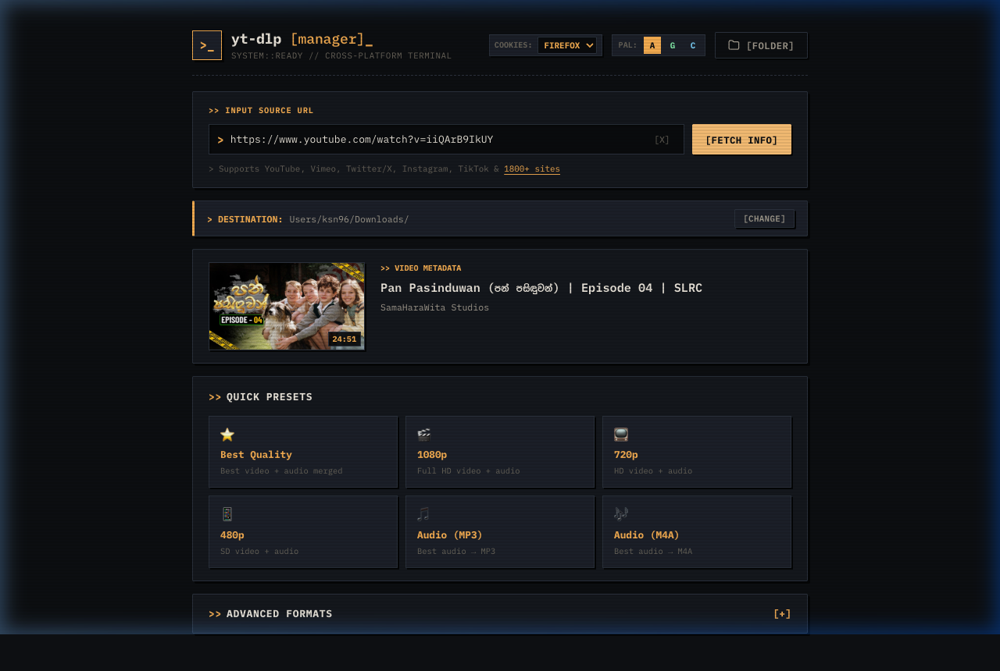
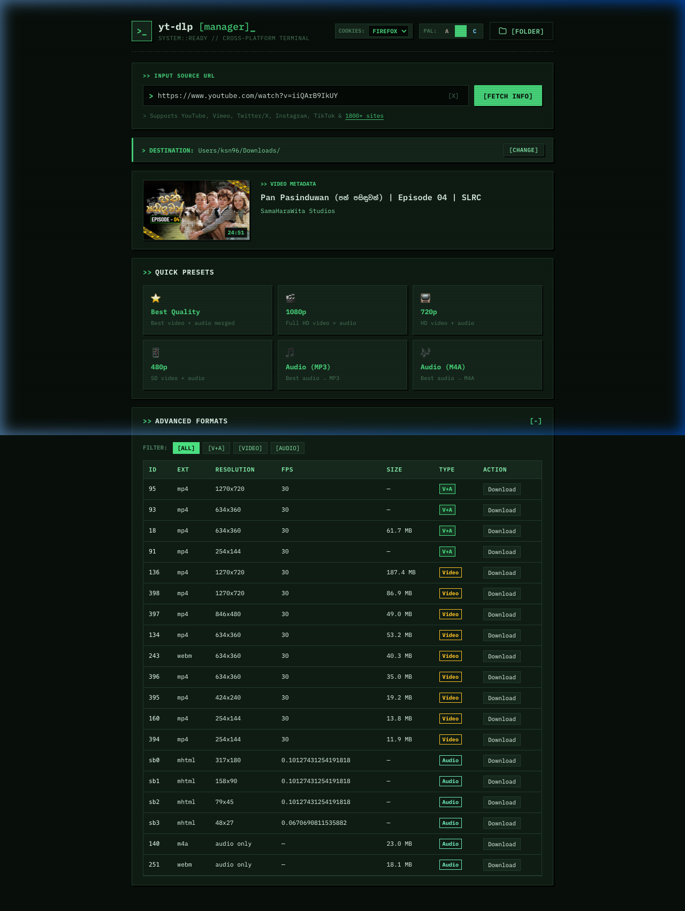
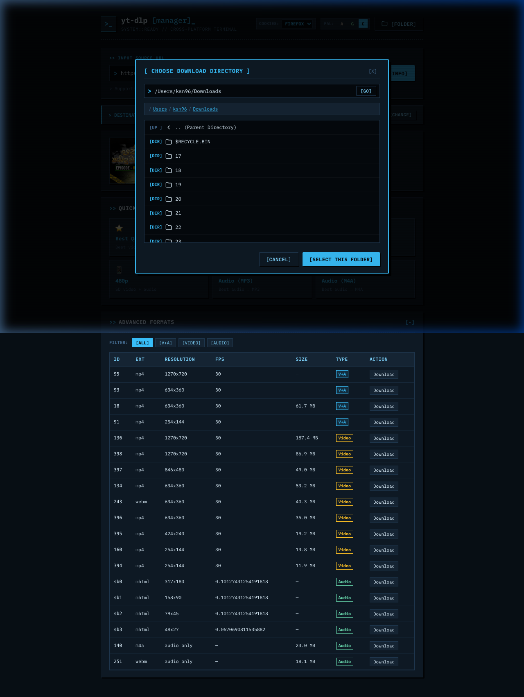

<div align="center">

# `yt-dlp [manager]`

### A clean, simple retro desktop interface for [yt-dlp](https://github.com/yt-dlp/yt-dlp)

[](https://www.python.org/)
[](https://fastapi.tiangolo.com/)
[](https://github.com/yt-dlp/yt-dlp)
[](https://fonts.google.com/specimen/IBM+Plex+Mono)
[](#)
[](LICENSE)

<br/>



</div>

---

## Highlights

- 🍪 **Age-Restricted & Auth Support** — Built-in **Cookie Sharing** from Chrome, Firefox, Safari, Brave, or Edge so you can download age-restricted, sensitive, and signed-in videos seamlessly.
- 📁 **Configurable Download Destination** — Dedicated retro directory browser modal with breadcrumbs, subfolder drilldown, and persistent folder saving in `config.json`.
- ⚡ **One-Click Quick Presets** — Instantly download **Best Quality**, **1080p**, **720p**, **480p**, **MP3 Audio (192kbps)**, or **M4A (AAC)**.
- 🎛️ **Advanced Stream Inspector** — Interactive table of every available video and audio format stream with filtering (`[V+A]`, `[VIDEO]`, `[AUDIO]`).
- 📊 **Real-time WebSocket Streaming** — Live progress bar, speed (MB/s), downloaded bytes, and ETA streamed directly to the UI.
- 🛡️ **Intelligent Error Handling** — Clean, human-friendly messages for playlists, age gates, network issues, and missing cookies instead of raw terminal stack traces.
- 🌐 **1,800+ Supported Sites** — YouTube, Vimeo, Twitter/X, Instagram, TikTok, Reddit, Twitch, and [many more](https://github.com/yt-dlp/yt-dlp/blob/master/supportedsites.md).

---

## Visual Tour

| **Green Phosphor (`G`) & Stream Inspector** | **Retro Directory Browser (`[CHANGE]`)** |
|:---:|:---:|
|  |  |

---

## Prerequisites

1. **Python 3.9+** — [python.org](https://www.python.org/downloads/)
2. **ffmpeg** *(recommended for merging best video + best audio streams)*:
   - **macOS**: `brew install ffmpeg`
   - **Windows**: `choco install ffmpeg` or download from [ffmpeg.org](https://ffmpeg.org/download.html)
   - **Linux (Debian/Ubuntu)**: `sudo apt install ffmpeg`
3. **Node.js** *(optional, recommended for solving YouTube JavaScript `n-challenge`)*:
   - Already bundled with modern Node installations (`node -v`).

---

## Quick Start

```bash
# 1. Clone the repository
git clone https://github.com/lewandowski96/yt-dlp-manager.git
cd yt-dlp-manager

# 2. Run the launcher (auto-installs dependencies on first run)
python run.py
```

The launcher will:
1. Verify and automatically install missing Python dependencies (`fastapi`, `uvicorn`, `yt-dlp`, `yt-dlp-ejs`).
2. Start the local server at `http://127.0.0.1:8899`.
3. Automatically launch your default browser to the UI.

---

## Usage Guide

### 1. Basic Downloads
1. Paste a video link into the URL input (supports automatic clipboard paste on focus).
2. Click **`[FETCH INFO]`** (or press Enter).
3. Click any **Quick Preset** button (e.g. `1080p` or `Audio (MP3)`).
4. Watch real-time download progress. When finished, click **`[OPEN FOLDER]`** to reveal the file.

### 2. Downloading Age-Restricted or Private Videos
If a video requires YouTube sign-in, select your primary browser from the **`COOKIES:`** dropdown in the header:
- **`CHROME`** | **`FIREFOX`** | **`SAFARI`** | **`BRAVE`** | **`EDGE`**
- The app will borrow your active session cookies without saving or leaking passwords, allowing age-restricted content to download directly.

### 3. Changing Download Folder
- The active download path is shown in the **`> DESTINATION:`** bar.
- Click **`[CHANGE]`** to launch the interactive retro folder browser, click through breadcrumbs or folders, and hit **`[SELECT THIS FOLDER]`**.
- Your custom destination is persisted across sessions in `config.json`.

---

## Project Structure

```
yt-dlp-manager/
├── run.py                  # Cross-platform launcher & dependency checker
├── config.json             # User preferences (download dir, cookie source)
├── backend/
│   ├── server.py           # FastAPI backend (REST API + WebSocket progress)
│   └── requirements.txt    # Python dependencies
├── frontend/
│   ├── index.html          # Semantic HTML5 layout (IBM Plex Mono)
│   ├── style.css           # Retro phosphor stylesheet & animations
│   └── app.js              # State management, WebSocket & theme handling
├── assets/
│   └── screenshots/        # High-resolution README previews
└── downloads/              # Default downloads directory (auto-created)
```

---

## REST & WebSocket API

| Endpoint | Method | Description |
|---|---|---|
| `/api/info?url=...` | `GET` | Extract video metadata, quick presets, and format streams |
| `/api/downloads-dir` | `GET` | Retrieve currently configured download directory |
| `/api/downloads-dir` | `POST` | Update and persist download directory path |
| `/api/browse?path=...` | `GET` | Cross-platform directory listing with drives / breadcrumbs |
| `/api/cookies` | `GET` | Get current cookie source (`chrome`, `firefox`, `none`, etc.) |
| `/api/cookies` | `POST` | Set and persist cookie source |
| `/api/open-downloads` | `POST` | Open active download folder in system file manager |
| `/ws/download` | `WebSocket` | Stream download job with real-time speed, ETA, and progress |

---

## Configuration (`config.json`)

Settings are stored locally in `config.json` at the root of the project:

```json
{
  "downloads_dir": "/Users/username/Downloads",
  "cookie_source": "chrome"
}
```

---

## License

This project is licensed under the [MIT License](LICENSE).
